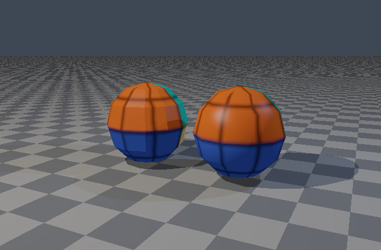
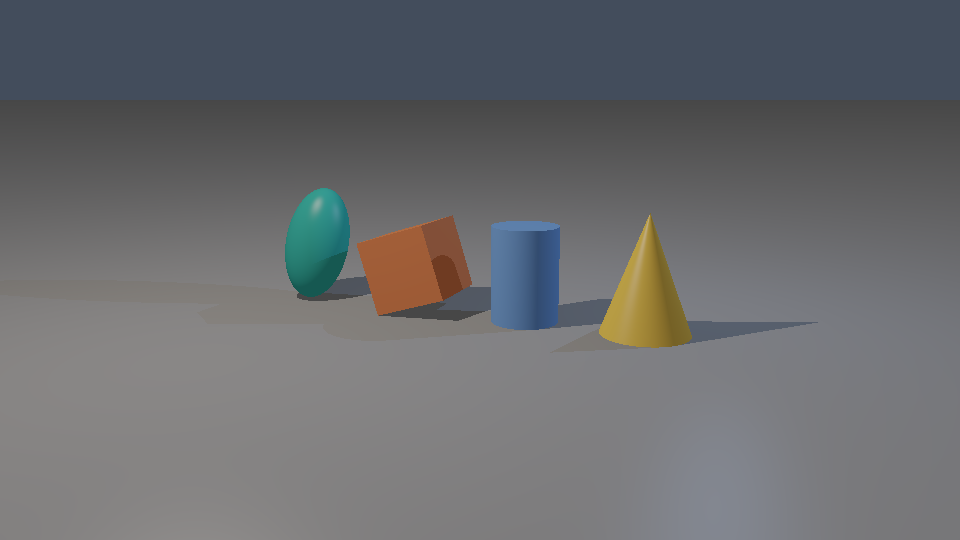
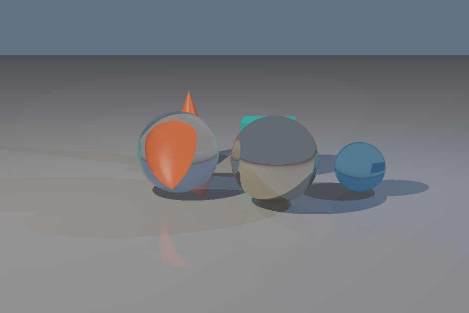
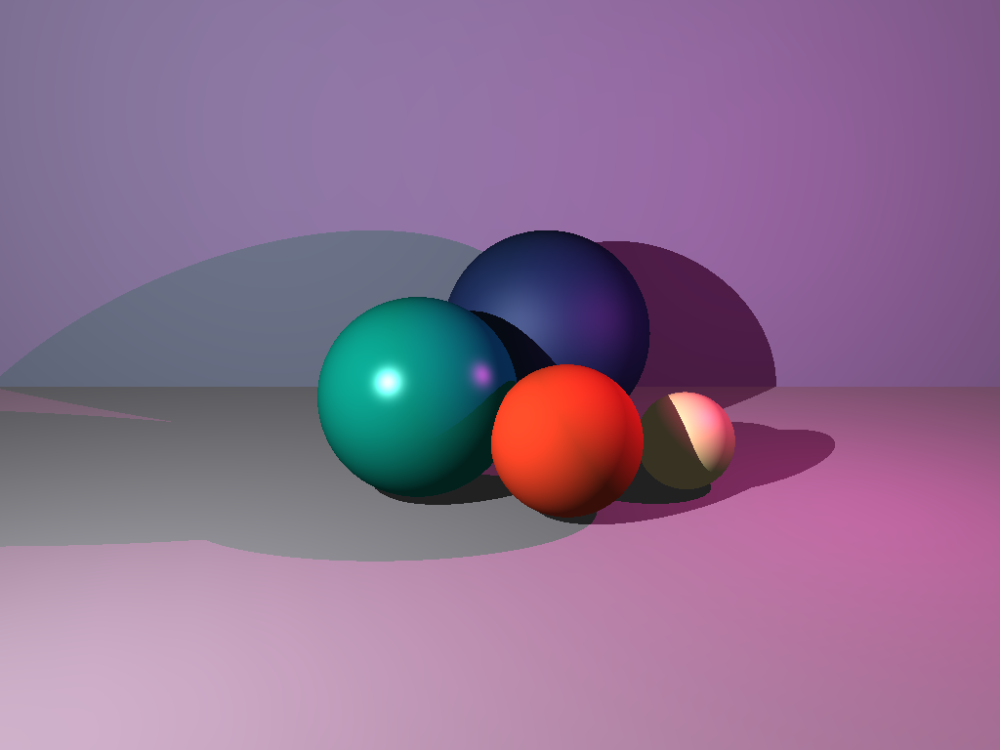

# Rust CPU Renderer

An AI-assisted graphics portfolio project extending Heather's early-semester Rust ray tracer. Development is in progress; [STATUS.md](STATUS.md) distinguishes verified features from the full [implementation plan](PLAN.md).

```sh
cargo run --release --locked -- smoke --width 640 --height 480 --output output/smoke.png
cargo run --release --locked -- validate scenes/mesh.json
cargo run --release --locked -- render scenes/mesh.json --output output/mesh.png
cargo run --release --locked -- render scenes/glass.json --output output/glass.png
cargo test --locked
cargo fmt --check
cargo clippy --all-targets -- -D warnings
```

Verified features: perspective/orthographic cameras; affine sphere, plane, box, capped cylinder, and capped cone instances; outward/oriented normals and UVs; educational Lambert/Blinn–Phong lighting; point-light hard shadows; recursive mirrors/glass with Fresnel and total internal reflection; floating-point accumulation; exposure, Reinhard tone mapping, and sRGB PNG output. A library backs the command-line application. Run `cargo run --release --locked --example shapes` to render both camera studies into `output/`.

Versioned JSON scenes now support named materials/textures, reusable OBJ meshes, transform groups, relative asset paths, checker/image textures, and flat/smooth triangle shading. See the [scene format](docs/SCENE_FORMAT.md). All example assets are included and work offline after dependencies are installed.



Current limits: one center sample per pixel, serial rendering, hard point-light shadows, and educational materials. Selectable brute-force, binned-SAH BVH, and reference octree traversal now cover both instances and mesh triangles. Antialiasing, physical HDR lighting, animation, and procedural generation remain in progress. Benchmark measurement is underway; no speedup is claimed yet.



`cargo run --release --example legacy` reproduces the original five 1024×768 demonstrations in the current directory. Run it from an output directory using `--manifest-path` to keep generated files out of the repository root. Legacy output retains the original display convention for comparison.

Run `cargo run --release --locked --example glass` for mirror/refraction and inside-glass studies. Glass uses an educational additive model with opaque shadow rays; physical materials, diffuse indirect light, and caustics remain future work.





The broader renderer is being built and tested through documented milestones. This repository is separate from the manually authored class submission. Heather directs and reviews the portfolio project; Codex assists with implementation, testing, debugging, and documentation. No repository license has been selected.
