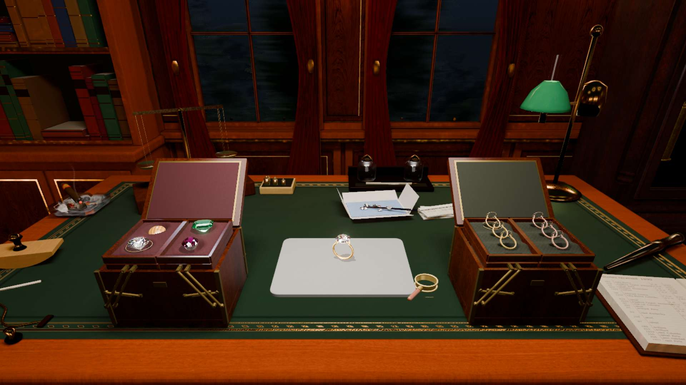

# The Diamond Express

A jeweler’s workshop aboard a Victorian train. Explore the room, inspect gemstones through a loupe, and operate the safe, gramophone, globe and clock.

**[Enter the workshop](https://thediamondexpress.live/)** · [Image gallery](https://thediamondexpress.live/gallery.html)



## Built with

- **Three.js and GLSL:** live gemstone reflection, refraction and absorption; moving objects, sound and camera transitions.
- **Blender and Cycles:** authored room geometry and lighting calculated ahead of time, with separate surface textures and live reflections.
- **Rust and Rayon:** a separate offline renderer with shared mesh instances, accelerated ray intersections and deterministic parallel rendering.

The website’s initial assets were reduced from **245 MB to 48 MB** through smaller textures, a lighter ring mesh and detail loaded on demand. Controlled cold loading fell from **53 s to 12 s** on an M1 Max at 40 Mbps. [Measurements and quality tradeoffs](docs/STARTUP_FAST_DELIVERY.md).

## Run locally

Requires Node.js 20+. No npm installation, account or API keys needed.

```sh
git clone https://github.com/HeatherDHoltz/renderer-ai.git
cd renderer-ai
npm run dev --prefix workbench
```

Open http://127.0.0.1:4173/. Click an area to approach it, drag to look around, scroll to zoom, and press Escape to return to the desk. Local builds use the original room assets; the published site uses smaller delivery copies.

For an offline Rust image, install stable Rust and run:

```sh
cargo run --release --locked -- render scenes/ai_gallery.json --width 600 --height 400 --spp 64 --no-progressive --output output/preview.png
```

## Further reading

[Development](docs/DEVELOPMENT.md) · [Rendering](docs/RENDERING.md) · [Benchmarks](docs/BENCHMARKS.md) · [Asset credits](docs/ASSETS.md)

Heather Holtz designed the experience, edited the Blender room, selected assets and audio, and directed visual and interaction revisions. AI agents contributed substantial implementation and tooling. [Contribution details](docs/RESUME_AUDIT.md). Her manually authored class project remains separate. No repository-wide license has been selected; third-party licenses still apply.
