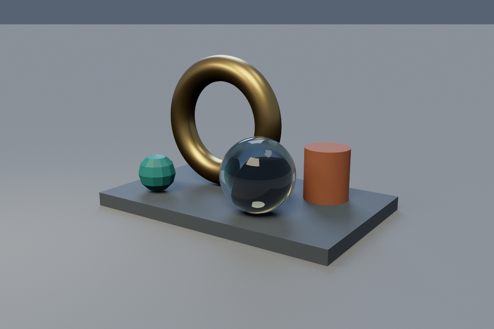
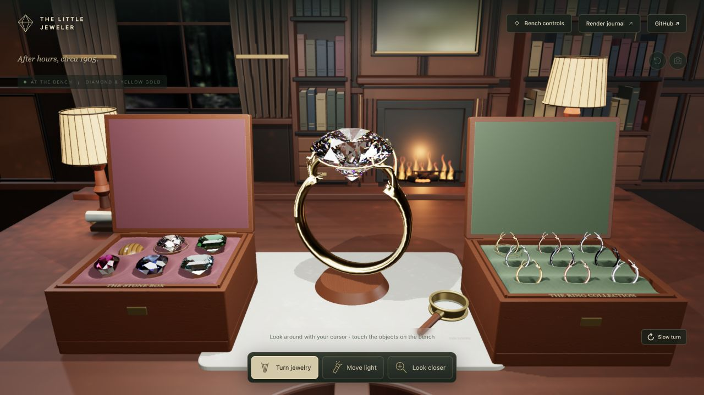
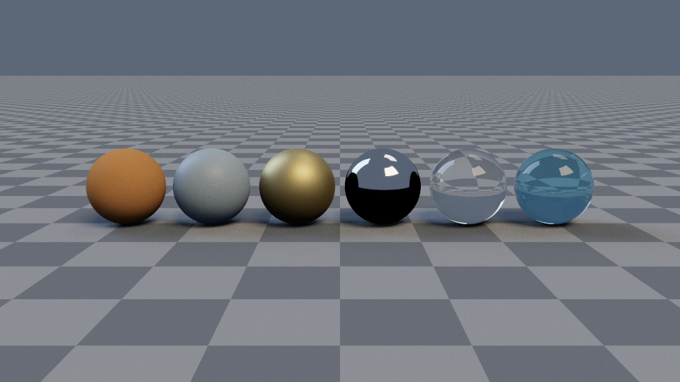

# Rust CPU Renderer

[](https://github.com/HeatherDHoltz/renderer-ai/actions/workflows/ci.yml)

A Rust ray tracer with affine geometry, indexed meshes, SAH acceleration, HDR lighting, glass, animation, and procedural scenes. An AI-assisted portfolio project directed by Heather Holtz, extending her early-semester renderer in a separate repository.



## Explore the workshop

[The Little Jeweler](workbench/README.md) is a separate interactive browser companion: an early-1900s-inspired first-person study with Blender/Cycles-baked room lighting, 12 gemstones, six metals and 18 finish samples, a movable examination light without a visible fixture, two-layer velvet cases that unfold for inspection, gentle cursor gaze, and an animated 3D loupe. Live gem cuts trace internal facet reflections and RGB dispersion; a room probe and directly intersected finite light apertures drive jewelry reflections, while an optional GPU photon pass adds refracted RGB light to the bench. Ruby and sapphire colors are fitted to published GIA absorption data; other colors are documented appearance studies. Its Three.js GPU materials are distinct from this Rust renderer and the optional Mitsuba reference images.

[Open the private hosted preview](https://heathers-little-jeweler.zoeholtz2000.chatgpt.site) (owner’s ChatGPT sign-in required).



With Node.js 20 or newer, run `npm run dev --prefix workbench` and open `http://127.0.0.1:4173/`. No npm installation, API keys, or asset downloads are needed. Click gems and metals in their felt boxes, drag the jewelry, select Move light and sweep its illumination, and click the loupe to lift it. Bench controls provide keyboard-accessible alternatives.

## Run it

Install stable Rust and clone this repository. Runtime assets are bundled, including project-generated assets and credited third-party gem meshes; no asset downloads or API keys are needed. Cargo downloads dependencies on the first build.

```sh
git clone https://github.com/HeatherDHoltz/renderer-ai.git
cd renderer-ai
cargo run --release --locked -- smoke
cargo run --release --locked -- render scenes/ai_gallery.json --width 600 --height 400 --spp 64 --no-progressive --output output/preview.png
```

For the full 1200×800, 512-spp hero with progressive previews and raw HDR:

```sh
cargo run --release --locked -- render scenes/ai_gallery.json --output output/hero.png --hdr-output output/hero.hdr
```

## Implemented

| Area | Features |
| --- | --- |
| Geometry | Perspective/orthographic cameras; validated affine instances of sphere, plane, box, capped cylinder/cone; indexed OBJ triangles, barycentrics, flat/smooth normals, UV textures |
| Educational transport | Lambert/Blinn–Phong, hard/soft shadows, recursive mirrors/glass, Schlick Fresnel, total internal reflection |
| Physical direct lighting | Lambert and GGX/Smith/Schlick metal/roughness, exact Fresnel glass, homogeneous absorbing gems, anisotropic stone sheen, HDR environment importance sampling and MIS |
| Acceleration | Two-level binned-SAH BVH, reference octree, brute force, differential tests and query counters |
| Rendering | Seeded AA, Rayon tiles, same-build determinism across workers/tiles/batches, progressive PNG previews |
| Color | Linear accumulation, exposure, Reinhard/linear tone mapping, sRGB PNG and linear Radiance RGBE output |
| Scenes | Strict versioned JSON, relative assets, named instances, transform hierarchies, quaternion keyframes and image sequences |
| Generation | Seeded scatter, bounded branching L-system, JSON schema and constrained AI scene-authoring workflow |



[Gallery and reproduction commands](docs/GALLERY.md) · [Scene format](docs/SCENE_FORMAT.md) · [Architecture](docs/ARCHITECTURE.md) · [Physical model](docs/PHYSICAL.md) · [Animation](docs/ANIMATION.md) · [Procedural generation](docs/PROCEDURAL.md)

[Gemstone study](docs/GEMS.md): diamond, emerald, ruby, sapphire, amethyst, and aquamarine on downloaded/adapted cuts, plus tiger's-eye-inspired cabochons and a moving-light sheen demonstration. Includes artist credits and optical limitations.

[Optional Mitsuba reference study](docs/MITSUBA.md): a separate Python environment for layered tiger's-eye materials and directional volume scattering. These reference renders use Mitsuba, not this Rust engine.

```sh
cargo run --release --locked -- validate scenes/mesh.json
cargo run --release --locked -- animate scenes/animation.json --frames 0:16 --fps 8 --output output/animation
cargo run --release --locked -- generate scenes/generators/garden.json --output output/garden.json
cargo run --release --locked -- render output/garden.json --output output/garden.png
```

## Evidence

98 tests cover geometry/math, transport, mesh/texture IO, acceleration agreement, sampling, HDR/BRDFs, thread/progressive equivalence, animation, generation, gemstone absorption, and anisotropic sheen. Verify locally:

```sh
cargo fmt --check
cargo clippy --locked --all-targets -- -D warnings
cargo test --locked
cargo build --release --locked
python3 scripts/check_examples.py
```

The offline example check validates/renders every included scene, both generators, and a PNG/HDR frame sequence. GitHub CI runs these checks on Linux and macOS. [Release verification](docs/RELEASE.md) records clean-checkout evidence.

[Measured benchmarks](docs/BENCHMARKS.md), on Apple M1 Max:

- Fixed 4,096-ray workload over 8,192 mesh triangles: median 734.619 ms brute force versus 2.873 ms BVH (255.66×); intersection queries, not full renders.
- Area-light render at 320×224/32 spp: median 0.8746 s with one worker versus 0.1003 s with ten (8.72×), with exact linear-film agreement.

Reports include clean engine commits, hardware, settings, warmups, five measured runs, ranges, build costs, and raw data. Gains depend on the scene and machine.

## Limits and authorship

Physical mode integrates direct point/area/environment light plus recursive ideal glass and homogeneous gem absorption. It has no diffuse/glossy interobject indirect transport, nested media, spectral dispersion, or caustics. Glass shadows are opaque; blocked metal environment reflections can appear black. Absorbing meshes require a closed oriented surface with a validated common interior kernel; chatoyancy is an anisotropic surface approximation. Area sources are not intersectable geometry. OBJ supports triangles and convex planar quads, not full MTL; texture prefiltering and motion blur are absent. [Model details and limitations](docs/PHYSICAL.md) are explicit.

Heather directs and reviews this portfolio project; Codex assisted with implementation, tests, debugging, scene authoring, and documentation. The manually authored class renderer remains separate and unchanged. [AI authoring workflow](docs/AI_SCENE_AUTHORING.md) and [portfolio notes](docs/PORTFOLIO.md) explain that collaboration. [Asset provenance](docs/ASSETS.md) covers all included models and images. No repository license has been selected.
