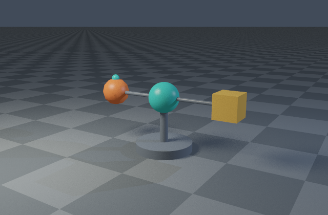
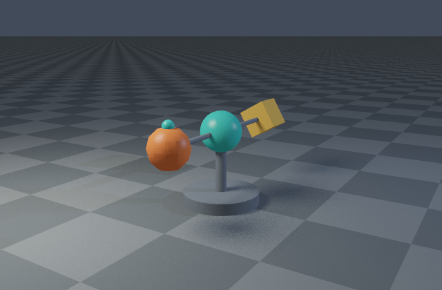
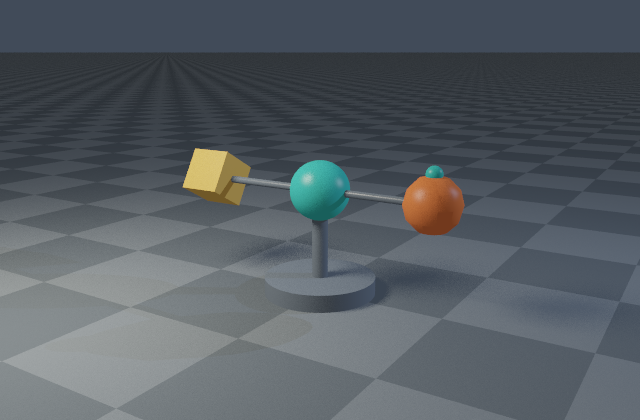

# Hierarchies and keyframe animation

```sh
cargo run --release --locked -- animate scenes/animation.json --frames 0:16 --fps 8 --output output/animation
cargo run --release --locked -- render scenes/animation.json --time 1 --output output/animation-middle.png
```

The included kinetic sculpture has an animated rotor, two orbiting objects, a cube with its own rotation track, and a third-level moon/arm. An OBJ satellite shares the same scene graph as analytic primitives. Frame 0, 8, and 16 correspond to 0, 1, and 2 seconds:





## Format and interpolation

An object's optional `animation` contains one complete TRS track:

```json
{
  "name": "rotor",
  "transform": {"translation": [0, 1.6, 0]},
  "animation": {"keyframes": [
    {"time": 0, "translation": [0,0,0], "rotation": [0,0,0,1], "scale": [1,1,1]},
    {"time": 1, "translation": [0,0,0], "rotation": [0,0.70710678,0,0.70710678], "scale": [1,1,1]}
  ]}
}
```

Times are seconds; every key specifies translation, unit quaternion rotation in **x,y,z,w** order, and scale. Local composition is `static_TRS * animated_TRS(time)`, so a static translation places an animated rotor's pivot. World composition is `parent_world * local`. All nodes, including groups and geometry-bearing parents, can animate. Object ordering does not affect hierarchy evaluation. Shape IDs follow geometry-bearing object order and remain stable across times.

Translation and scale interpolate linearly; rotation uses shortest-arc slerp with sign correction and normalized linear interpolation for nearly equal quaternions. Key times must strictly increase; duplicates are rejected. Times before/after the track clamp to its first/last key. One key is a constant transform. Each track has 1..4096 keys, and a scene at most 100,000 combined keys. All key segments validate even when rendering another time. Scale signs cannot change across a segment because that would cross a singular transform. Near-unit quaternions (squared-length error ≤0.001) normalize on load; invalid quaternions are rejected. Requested/key times are finite and bounded to ±1,000,000 seconds.

Static scene loading and `validate` evaluate time zero. `render --time SECONDS` selects any other bounded time. Every build loads assets, evaluates the complete graph, validates composed affine transforms, and rebuilds mesh-local and scene acceleration. This favors a clear correctness baseline over asset caching/refit optimization. No stale bounds carry across frames. Cameras and lights are static world-space definitions; object/group animation, not camera/light tracks, is supported. There is no motion blur, deformation, skinning, or physics.

## Frame sequence behavior

`animate` uses `--frames FIRST:LAST`, **both endpoints inclusive**, and `time = start_time + frame / fps`. Defaults: `0:60`, 24 fps, start time 0, output `output/frames`. Optional `--width`, `--height`, `--spp`, and `--threads` override scene values; `--hdr` adds raw RGBE for each final frame. Filenames are `frame-000000.png` etc. Numbering is absolute, so rendering `24:48` starts at frame 24 and time one second at 24 fps. Up to 10,000 frames per call, indices ≤1,000,000, fps in [0.001,1000], and at most 2^36 total camera samples per call. Split larger jobs into ranges.

Scenes retain their seed and absolute per-pixel sample indices at every time. Frame sequence output matches direct static rendering at that time on the same build, regardless of worker count. Progressive scene settings work within each frame. A dedicated worker pool and immutable scene are recreated per frame. Rerunning a range replaces the named output frames. Normal Ctrl-C preserves finished frames and any completed PNG prefix of the current frame; no checkpoint-resume is implemented.

`animation.json` records only completed frames from the current invocation, their times, render settings, and measured build/render-write durations. It is replaced after each completed frame. Old files outside the selected range are not automatically deleted; use separate output folders for different sequences. The manifest's final range shows which files belong to the current run.

Optional video encoding after rendering 24-fps frames:

```sh
ffmpeg -framerate 24 -i output/frames/frame-%06d.png -c:v libx264 -pix_fmt yuv420p output/animation.mp4
```

FFmpeg is not required to build, test, or render. The repository gallery retains selected actual frames rather than requiring a video player.

`tests/animation.rs` checks key endpoints/clamping, midpoint TRS, quaternion sign equivalence and shortest arc, invalid times/scales/quaternions/ranges, order-independent hierarchy composition, fresh BVH/octree mesh-instance bounds, stable IDs, and CLI sequence equality with direct per-time renders from another working directory.
