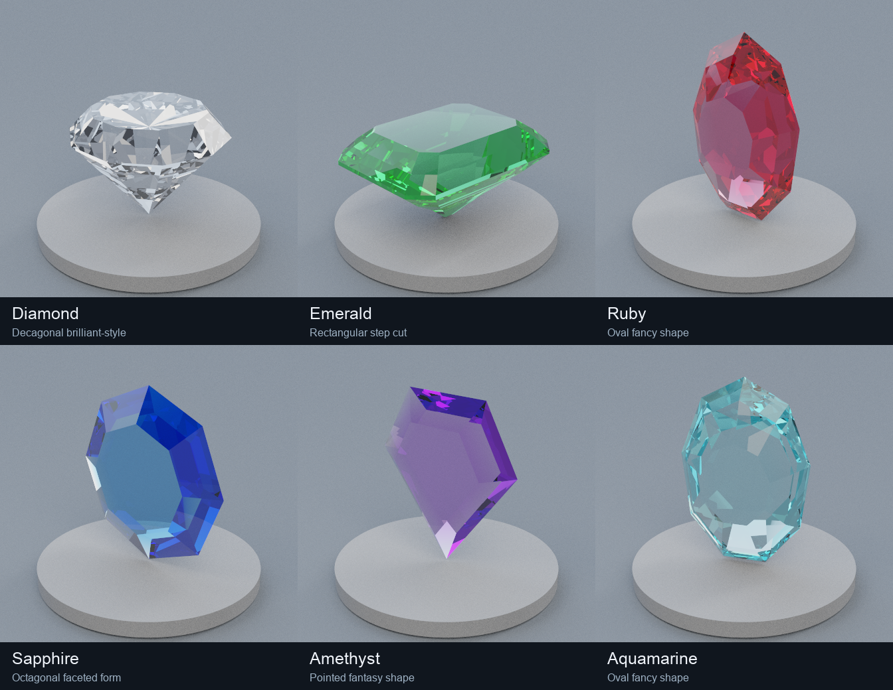
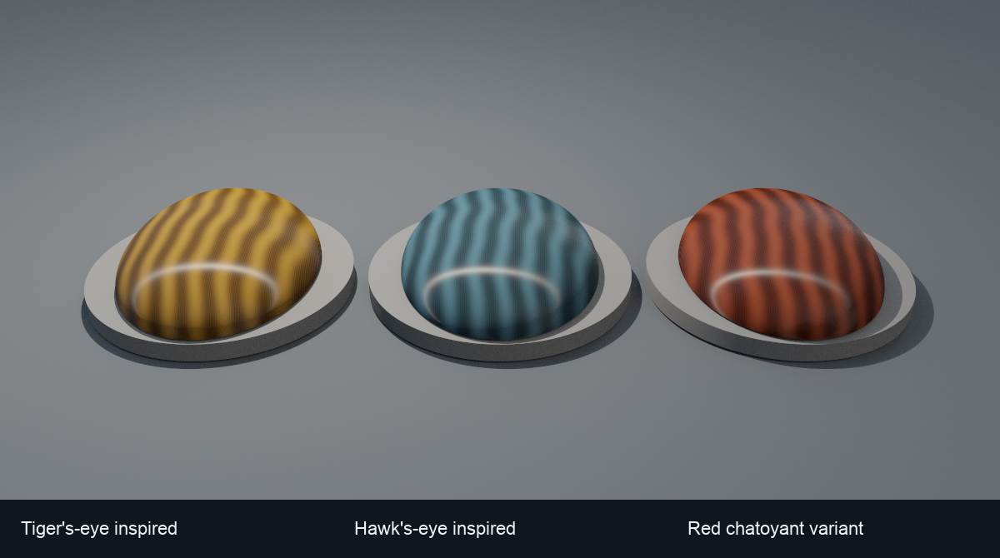
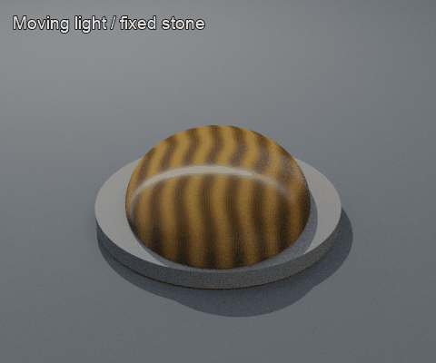

# Transmitting gemstones and chatoyant stones

This study combines real downloaded meshes with new material behavior in the Rust renderer. All images are actual renderer output; Pillow only arranges panels, adds labels, and encodes the light-sweep GIF.



The four online **Jewel** meshes are by **Zsky**, [CC BY 3.0](https://creativecommons.org/licenses/by/3.0/): [decagonal brilliant-style](https://poly.pizza/m/velVo80s1D), [oval fancy](https://poly.pizza/m/fvsPsdeT7T), [pointed fantasy](https://poly.pizza/m/fOScYcI2Oh), and [octagonal step-style](https://poly.pizza/m/KfOELiDp7l). These cut labels describe their appearance, not a gemological certification. Conversion, normalization, winding/topology checks, source hashes, and license notices are retained in [asset credits](../assets/gems/ATTRIBUTION.md) and [sources.json](../assets/gems/sources.json). The rectangular emerald-style step cut and smooth domed cabochon are additional project-generated meshes.

## Material choices

| Study stone | Scalar IOR | Shape |
| --- | ---: | --- |
| Diamond | 2.42 | Downloaded decagonal brilliant-style |
| Emerald | 1.58 | Generated rectangular step cut |
| Ruby | 1.77 | Downloaded oval fancy |
| Sapphire | 1.77 | Downloaded octagonal form, outer hull repaired |
| Amethyst | 1.54 | Downloaded pointed fantasy |
| Aquamarine | 1.58 | Downloaded oval fancy |

The scalar IORs approximate GIA's referenced ranges for [diamond](https://www.gia.edu/diamond), [emerald](https://www.gia.edu/emerald), [ruby](https://www.gia.edu/ruby), [sapphire](https://www.gia.edu/sapphire), [amethyst](https://www.gia.edu/amethyst), and [aquamarine](https://www.gia.edu/aquamarine). Color absorption is artist-chosen RGB, not measured spectral data. Cut and material are separate: any of these meshes can use another material.

`gemstone` adds homogeneous Beer–Lambert absorption inside an isolated closed solid. Every traveled segment gets `T = exp(-absorption * distance)`, where absorption is RGB per **world unit** and distance is the actual ray length. Reflections inside the gem accumulate more distance; entry reflections are not colored by a path they did not take. Fresnel splitting, refraction, TIR, radiance eta factors, and geometric offsets remain active. The old `dielectric` material retains its per-interface tint behavior.

```json
{"physical":{"model":"gemstone","ior":1.58,"absorption":[1.65,0.045,1.05]}}
```

Absorption channels must be finite in [0,1000]; IOR is [1,4]. Zero absorption is clear. Object scale changes the traveled distance and therefore the color. `gemstone` does not accept a surface color texture, because this model's absorption is homogeneous. Use a consistently outward, watertight mesh with flat facet shading. The loader checks closed oriented edges and requires a common interior kernel at the bounds center (strictly behind every face plane), with a ceiling of 100,000 triangles/200,000 positions per absorbing mesh. Finite closed analytic solids also work; planes are rejected. This is a deliberately restricted solid model, not arbitrary concave-volume transport. The fourth downloaded mesh is repaired to its outer hull to meet those requirements; its source license and adaptation notes are preserved.

A single current-object medium is tracked; nested/intersecting refractive solids are unsupported. Cameras inside a gem infer the medium from the first back-facing boundary. Contradictory distant boundaries report invalid radiance rather than silently applying the wrong medium. There is no volumetric scattering, spectral dispersion/rainbow fire, fluorescence, birefringence, or caustics. Depth/throughput limits can darken long internally reflected paths. These are optical approximations for a renderer demonstration, not gem-grading simulations.

Facet-edge regressions also improved mesh hit positioning: barycentric geometry is reconstructed in double precision before world conversion, avoiding cancellation from a rounded long-ray t near small facets. Absorbing inside rays move slightly toward the validated interior kernel rather than crossing adjacent faces with a single-normal offset. A bounded query filter suppresses contradictory same-solid self hits only within 32 f32 epsilons times the origin coordinate scale; other intersections retain the normal interval policy. Edge cases are tested with brute force, BVH, and octree. This remains numerical handling within the documented scale limits, not a formal universal error bound.

## Tiger's eye and directional sheen





The stone and camera stay fixed in the GIF; only the point light moves. Surface stripes stay fixed while the reflected band moves. Gold and blue studies are tiger's-eye/hawk's-eye inspired; the red stone is an artistic chatoyant variant.

GIA describes [tiger's eye](https://www.gia.edu/gia-museum-exhibit-tigers-eye-quartz) as a fibrous quartz material with a silky reflected sheen. Its [2025 review](https://www.gia.edu/doc/summer-2025-phenomenal-gemstones.pdf) discusses aligned mineral inclusions and shows both tiger's eye and hawk's eye. Our `chatoyant` model is a **surface approximation**, using a striped base color and a directional anisotropic GGX highlight on a smooth cabochon. It does not trace light through individual fibers or reproduce the volume structure of natural tiger's eye.

```json
{"physical":{"model":"chatoyant","base_color":[1,1,1],"fiber_direction":[0,0,1],"roughness_along":0.18,"roughness_across":0.75},"texture":"gold"}
```

Fiber direction is finite, nonzero, and **world-space**; it does not automatically rotate with an object. It is projected into the shading tangent plane, with a finite fallback when parallel to the normal. Both roughnesses lie in [0.01,1], map to alpha=max(roughness²,0.001), and control GGX slope spread along/across that direction. Smaller along-fiber spread produces a band perpendicular to the fibers. The BRDF uses separable anisotropic Smith masking-shadowing, Schlick dielectric F0=0.04, and Fresnel-reduced Lambert diffuse. Sampling mixes cosine diffuse and stretched-GGX NDF reflection equally, includes the full PDF and null events, and uses the existing environment MIS. The surface lobe follows the model in [PBRT's microfacet discussion](https://www.pbr-book.org/4ed/Reflection_Models/Roughness_Using_Microfacet_Theory); code is independently implemented.

## Reproduce

All runtime assets are bundled. Render one stone or the chatoyant group without Python:

```sh
cargo run --release --locked -- render scenes/gem_emerald.json --output output/emerald.png
cargo run --release --locked -- render scenes/gem_tigers_eye.json --output output/tigers-eye.png
```

The six square views are 448×448/256 spp; the group is 1200×600/256 spp. The GIF uses twelve 480×400/64-spp lighting states, played forward/back at 100 ms per frame. Same seeds are retained. Captions name materials and stylized shapes; they do not add rendered effects.

```sh
# Optional asset regeneration; importing needs network, the other steps are offline.
python3 scripts/import_gems.py
python3 scripts/generate_gem_study.py
cargo run --release --locked --example generate_gem_environment
cargo build --release --locked
# Requires Pillow for labels/GIF assembly only; no other Python dependencies.
python3 scripts/render_gem_gallery.py
```

`tests/gemstones.rs` checks world-distance/thickness absorption, inside origins, the analytic sum of internally reflected slab paths, entry reflection, anisotropic isotropic-limit agreement/reciprocity/rotation/PDF/energy, invalid parameters, and the faceted near-tip regression across backends. The offline example script validates/renders all new scenes as well.
