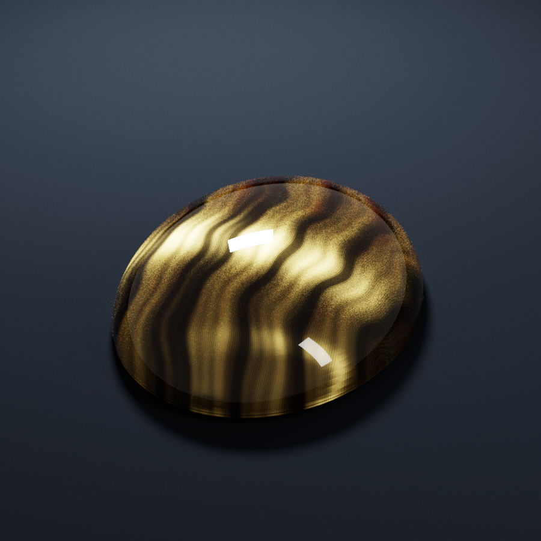
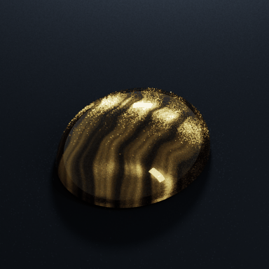
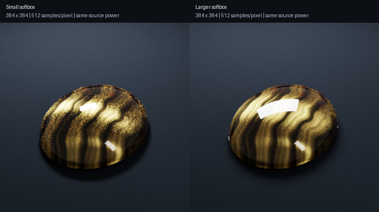

# Independent Mitsuba tiger's-eye study

This optional study uses **Mitsuba 3.9.1**, not the Rust renderer. It is an external appearance reference and an experiment in layered materials and directional volume scattering. The original Rust scene and shader are unchanged. Do not attribute these images or Mitsuba's transport features to the Rust engine.





The still is 900×900 at 3,072 samples per pixel. The light sweep uses eight 384×384 states at 512 samples per pixel, encoded as a 14-frame ping-pong loop. This is an artist-tuned approximation with remaining grain, not a measured reconstruction of a specimen.

## Setup and render

Python 3.12 or newer is required. The setup creates an isolated environment under ignored `output/`; it does not change your global Python packages. On Apple silicon the optional denoiser is downloaded from the official Open Image Denoise 2.3.3 release and checked against its pinned SHA-256. Runtime archives include their upstream license files; no repository license is assigned.

```sh
python3 scripts/setup_mitsuba.py --denoiser
output/mitsuba-venv/bin/python scripts/render_mitsuba_tigers_eye.py \
  --width 900 --height 900 --spp 3072 --grid 384 \
  --layered --density .1 --light-z -4 --exposure 1.65 --denoise
```

These are also the defaults, so after setup the same showcase can be rerun with `output/mitsuba-venv/bin/python scripts/render_mitsuba_tigers_eye.py --denoise`.

A faster preview:

```sh
output/mitsuba-venv/bin/python scripts/render_mitsuba_tigers_eye.py \
  --width 384 --height 384 --spp 256 --grid 128 \
  --layered --density .1 --light-z -4 --exposure 1.65
```

The final PNG, untouched linear EXR, raw display PNG when denoising, and settings/timing JSON are saved in `output/mitsuba-tigers-eye/`. Intermediate sample batches overwrite the preview PNG. Postprocessing consists of one global ACES-style tone curve, sRGB encoding, and optional OIDN image denoising; no highlight, color stripe, or stone detail is painted into the image afterward. The EXR always preserves the renderer's original radiance.

For a fixed-camera, fixed-stone light sweep:

```sh
output/mitsuba-venv/bin/python scripts/render_mitsuba_sweep.py --size 384 --spp 512 --denoise
```

Eight actual lighting states move the rectangular emitter along world Z from -8 to +5; the GIF plays forward and backward. The emitter's power stays fixed, so brightness also changes with distance. Camera, material, and stone geometry stay fixed. Each frame retains its EXR, PNG, and render settings. Pillow only encodes the GIF.

## Model and its limits

- A closed, smooth project-generated cabochon mesh has a separately refracting dielectric boundary, scalar IOR 1.545.
- A 3D heterogeneous medium contains varying extinction, RGB scattering albedo, and an **SGGX microflake orientation field**. The normal distribution is concentrated perpendicular to the local needle direction. The field's symmetric matrix has positive eigenvalues `1, 1, epsilon²`; trilinear interpolation preserves positive definiteness.
- The layered showcase adds an opaque effective fiber bed slightly below the quartz boundary. It uses anisotropic GGX with Mitsuba's **gold (Au) conductor preset**, modulated by a procedurally generated band/striations map. This gold response is an **artistic optical surrogate** for the golden fiber sheen, not a claim that real tiger's eye contains gold or that its inclusions have gold's measured optical constants.
- The quartz shell scatters and absorbs light between the outer surface and that effective layer. The showcase's density multiplier is 0.1. `--volume-only --density 1` renders the all-volume SGGX experiment, with no opaque internal bed. `--isotropic` replaces the volume phase function with isotropic scattering for an experiment; it does not change the bed's BRDF if the bed is enabled.
- Mitsuba's volumetric path tracer handles multiple scattering, refraction, internal reflection, and indirect illumination. Small sources behind a refractive boundary converge slowly because direct shadow-ray connections cannot bend through the quartz. Finite rectangular studio lights are used instead of point lights.
- Mineral bands and optical parameters are procedural and artist chosen. This is not a calibrated reconstruction of a real specimen. It does not explicitly model individual needles, iron oxide spectra, quartz birefringence, or wave interference.

## Grain and convergence

The low-sample animation contains sampling noise, especially around the strongly directional internal reflection. It is not a frame-rate artifact. Raising pixel resolution does not make the radiance estimate at each pixel less noisy; more samples and better light-path sampling are needed. Some fine longitudinal structure is deliberately authored into the material, while the bright isolated speckles are unwanted noise. OIDN can preserve some of these speckles as apparent detail, so enabling denoising is not a guarantee of a clean result.

Increasing sample count reduces ordinary Monte Carlo noise roughly with the square root of the sample count; four times as many samples typically halve its standard deviation. Refractive volume paths with small lights converge slowly. A larger studio light increases the range of useful directions, while also making the physical reflection softer and wider. `--key-width 2.2 --key-height 1.1` selects that alternative; emitter radiance is adjusted inversely with area to preserve its total power.



This comparison holds camera, material, 384×384 resolution, 512 samples per pixel, and source power fixed. It changes the light's physical size, so it also changes the shape of the reflection; it is not a comparison of two identical lighting solutions. Both images retain some noise.

The retained 900×900 still measured **859.54 s** of render-loop wall time and 0.85 s of scene construction. Individual animation states measured 44.06–50.55 s. These jobs overlapped on the same computer, so these figures are records of those runs, not isolated performance benchmarks or promises. Exact settings are in [the gallery render record](../gallery/mitsuba/render-record.json).

The code uses existing Mitsuba plugins rather than adding these capabilities to the Rust renderer. Realism depends on the chosen appearance model as well as the transport engine; a more advanced engine does not make an arbitrary material scientifically exact.

## CPU backends

The script uses `llvm_ad_rgb` when it finds `/opt/homebrew/opt/llvm@18/lib/libLLVM.dylib`, otherwise `scalar_rgb`. The existing `DRJIT_LIBLLVM_PATH` environment variable is respected. Pass `--variant scalar_rgb` to force the native scalar CPU backend; this backend also renders in parallel.

On Heather's Apple M1 Max/macOS 14.6.1, LLVM 18.1.8 was installed as a keg-only Homebrew package to enable vectorized CPU rendering. No shell profile or system compiler selection was changed. Mitsuba's Metal backend requires macOS 15 or newer, so it is not used here. On a fresh compatible Mac, vectorized CPU rendering is optional:

```sh
brew install llvm@18
```

Sampling is split into bounded batches to avoid allocating an entire high-sample image as one huge JIT wavefront. Every batch uses an independent deterministic seed. Reported wall times include `mi.render`, synchronization, and intermediate preview writes; scene construction is recorded separately. They are individual run measurements, not benchmark comparisons with the Rust shader.

## References

- [Mitsuba SGGX phase function](https://mitsuba.readthedocs.io/en/stable/src/generated/plugins_phase.html#sggx-phase-function-sggx)
- [Mitsuba heterogeneous media](https://mitsuba.readthedocs.io/en/stable/src/generated/plugins_media.html#heterogeneous-medium-heterogeneous)
- [Mitsuba rough conductor model](https://mitsuba.readthedocs.io/en/stable/src/generated/plugins_bsdfs.html#rough-conductor-material-roughconductor)
- [GIA's review of phenomenal gemstones, tiger's-eye section](https://www.gia.edu/doc/summer-2025-phenomenal-gemstones.pdf#page=24)
- [Official Open Image Denoise releases](https://github.com/RenderKit/oidn/releases/tag/v2.3.3)
