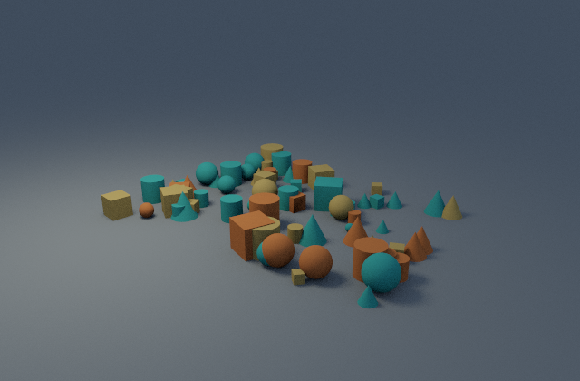
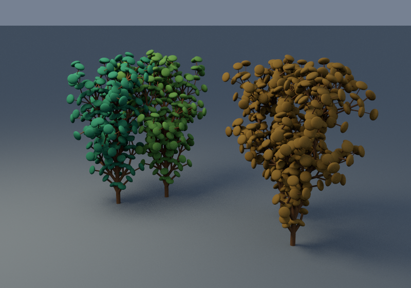

# Seeded scenes and bounded L-systems

Generation is offline. It writes ordinary v1 scene JSON, validates it with the renderer, and includes no asset paths or executable instructions. Generated scenes can move to another directory and render independently.

```sh
cargo run --release --locked -- generate scenes/generators/scatter.json --output output/scatter.json
cargo run --release --locked -- render output/scatter.json --output output/scatter.png
cargo run --release --locked -- generate scenes/generators/garden.json --output output/garden.json
cargo run --release --locked -- render output/garden.json --output output/garden.png
```




## Configuration

Generator configs have required `version: 1`, `seed` (u64), and `generator`; optional `render`, `camera`, and `palette` use defaults. Defaults: physical integrator, 768×512/64 spp, perspective camera [7,5,10] toward [0,1.5,0], three green/ochre linear RGB colors. Palette has 1..64 colors in [0,1]. A supplied `render` object uses normal scene defaults for omitted fields, so explicitly set `integrator: "physical"`. Only physical mode is generated. All other scene render/camera checks still apply. `--seed` overrides the config seed.

Every generated scene has a ground plane, diffuse palette/wood/ground materials, a downward rectangle light, and a constant environment. There is no global random state. Seed/index/dimension hashes select placement, size, geometry, material, or root rotation; same settings and build reproduce JSON exactly. Colors are linear, not display-space swatches.

`generator.kind: "scatter"` requires:

| Field | Meaning |
| --- | --- |
| `count` | 1..20,000 objects |
| `bounds_min`, `bounds_max` | Increasing 2-vectors in **XZ**, within ±1000 |
| `size` | Ordered min/max uniform scale, each [0.001,100] |
| `shapes` | 1..16 choices from sphere, box, cylinder, cone |

Placement is uniform in XZ; each object's bottom rests on y=0. Y-axis rotation is random. Centers obey the placement bounds; geometry may extend beyond them. Overlaps are allowed and no packing/collision solver is claimed. The checked scatter config uses 80 objects and three palette colors.

## L-system and turtle

`generator.kind: "lsystem"` requires `axiom`, a `rules` map, `iterations`, `step`, `angle_degrees`, `radius`, `taper`, `leaf_size`, `max_symbols`, `max_segments`, `count`, `bounds_min`, and `bounds_max`. Rewriting is simultaneous and deterministic. Rule keys are one uppercase ASCII letter or `f`; missing rules preserve symbols. Axiom and every replacement must have balanced brackets independently; expanded words validate again. Empty replacements are allowed, but the final word must contain an `F`.

| Symbol | Turtle behavior |
| --- | --- |
| `F` | Draw capped cylinder along local +Y, then move one step |
| `f` | Move without drawing |
| `+`, `-` | Local Z rotation ±angle |
| `&`, `^` | Local X rotation ±angle |
| `\`, `/` | Local Y rotation ±angle (roll around forward) |
| `\|` | Local Z rotation by 180° |
| `[`, `]` | Save/restore position, orientation, and radius |
| `!` | Multiply radius by taper, floor at 0.0001 |
| `L` | Add a palette-colored ellipsoidal leaf at the current position |
| Other uppercase letters | Inert nonterminals after rewriting |

Whitespace is ignored. Other characters are rejected. Rotations use a normalized quaternion frame; segment transforms map canonical cylinder +Y to turtle forward. Leaves scale as `[leaf_size, 0.5*leaf_size, leaf_size]`. Branches share a wood material; each tree selects a palette color. Radius changes only through `!`; it does not automatically taper after `F`.

Root origins use a jittered square grid inside XZ bounds, with seeded yaw and leaf color. A non-square count may leave grid cells empty. Root spacing does not prevent overlapping canopies. Repeated branches/leaves reuse named primitive definitions and local transforms under a tree parent.

Resource limits are enforced before unbounded expansion/output: config 1 MiB; 32 rules; 12 rewrite iterations; user-selected symbol budget 1..1,000,000; stack depth 256; 1..64 trees; user-selected total segment budget 1..50,000 across **all** trees; 100,000 scene objects including leaves/groups. Final pretty JSON must also fit the scene loader's 4 MiB limit, which can impose a tighter practical count. Expansion checks each append before allocating the replacement. Counts are ceilings, not performance promises.

Step is [0.0001,100], angle [0,180] degrees, radius [0.0001,10], taper [0.1,1], leaf size [0.001,10]. Turtle local coordinates stay within ±10,000; scene transform validation also applies. NaN/infinite parameters, malformed brackets, unknown symbols, or excessive growth produce errors. The included garden's three rewrite iterations generate four trees and 2,745 total scene nodes, with actual branches and leaf instances.

`tests/procedural.rs` checks same-seed JSON identity, different-seed variation, finite tiny renders, branch state restoration, invalid grammar/palette/bounds/counts, explosive rewrites/segment budgets, and portable CLI-generated output. The gallery uses the full commands above; bulk JSON stays under ignored `output/`.
