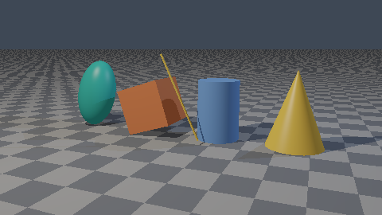
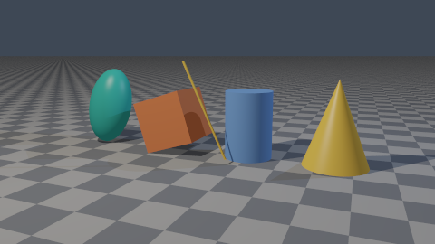
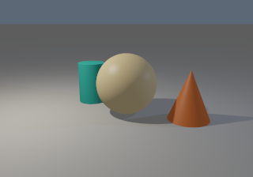
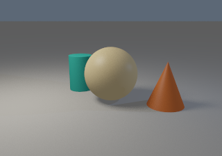
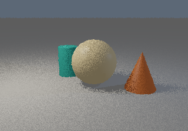

# Sampling and rectangular lights

`SampleKey` addresses pseudorandom values by global seed, pixel index, absolute sample index, dimension, and recursive branch stream. Camera dimensions are 0/1; each rectangular light gets its own pair starting at 2/3. Recursive reflection/transmission fork streams. No shared RNG or sample-count-dependent grid exists, so extending a render preserves its sample prefix. Values are in [0,1), generated from 24 hashed bits.

Scene render fields `spp`, `seed`, and `sampling` control sampling. `jittered` draws independent uniform camera offsets per pixel; `center` uses the pixel center for diagnostics while retaining stochastic lighting samples. The new default is jittered. Existing M0–M4 scenes explicitly select center to preserve their one-sample evidence. The standalone legacy/example wrappers retain center behavior. Limits: 1..16,384 spp and at most 2^30 total pixel samples.

One spp means one camera sample and **one uniform sample per rectangular light at each reached shading vertex**. Additional lights and recursive bounces add work. There is no separate hidden light-sample multiplier. All radiance is accumulated in linear RGB and divided by each pixel's actual sample count before exposure/tone mapping/sRGB conversion. Individual samples are not clamped.

## Area estimator

An area-light definition uses `kind: area`, `center`, full spanning vectors `edge_u`/`edge_v`, emitted linear RGB `radiance`, and optional `two_sided` (false by default). Normal is normalize(edge_u×edge_v); area is the cross-product length. For u,v uniform in [0,1), sample position is center+(u-0.5)*edge_u+(v-0.5)*edge_v. Source orientation matters.

For distance r and light-side cosine c, the area PDF is 1/A, the solid-angle PDF is r²/(c*A), and the returned radiance weight is Le*c*A/r². Surface shading supplies its receiver cosine/BRDF factors. The educational Whitted mode uses its existing empirical Lambert/Blinn–Phong coefficient convention; this area estimator does not turn that material into a physical BRDF. Physical shading is M7.

Tests compare the irradiance integral to the analytic projected solid angle of a centered rectangle, check distance/area factors and sidedness, and verify that geometry beyond the sampled source does not shadow it. Geometric-normal offsets place visibility origins correctly, and shadow intervals are recomputed to end at the sampled source. Glass still occludes shadow rays. Area emitters illuminate surfaces but are not directly intersectable visible geometry in this milestone.

At fixed emitted radiance, a larger area increases total emitted power as well as changing the penumbra. The size comparison below reduces radiance by the area ratio to hold power constant.

## Inspected comparisons

| Center sample | 128 jittered samples |
| --- | --- |
|  |  |

The thin tilted edge and foreground checker transitions become smoother. Very distant checker frequencies still need more samples or texture prefiltering; no MIP mapping is implemented.

| Small source, 128 spp | Large source, 128 spp |
| --- | --- |
|  |  |



The 1/16/128-sample soft-shadow outputs were inspected. Noise reduces with sample count and the larger source has a visibly wider penumbra. These are actual renderer outputs.

```sh
cargo run --release --locked -- render scenes/antialiasing.json --spp 1 --sampling center --output output/aa-center.png
cargo run --release --locked -- render scenes/antialiasing.json --spp 128 --output output/aa-128.png
cargo run --release --locked -- render scenes/soft_shadows.json --width 320 --height 224 --spp 1 --output output/soft-1.png
cargo run --release --locked -- render scenes/soft_shadows.json --width 320 --height 224 --spp 16 --output output/soft-16.png
cargo run --release --locked -- render scenes/soft_shadows.json --width 320 --height 224 --spp 128 --output output/soft-128.png
cargo run --release --locked -- render scenes/soft_shadows_small.json --width 320 --height 224 --spp 128 --output output/soft-small.png
```

The sample stream is tested in forward/reverse pixel order and in full versus split sample batches. Thread/tile/progressive tests now also verify the same sample stream and exact same-build linear sums; see [PARALLEL.md](PARALLEL.md).
